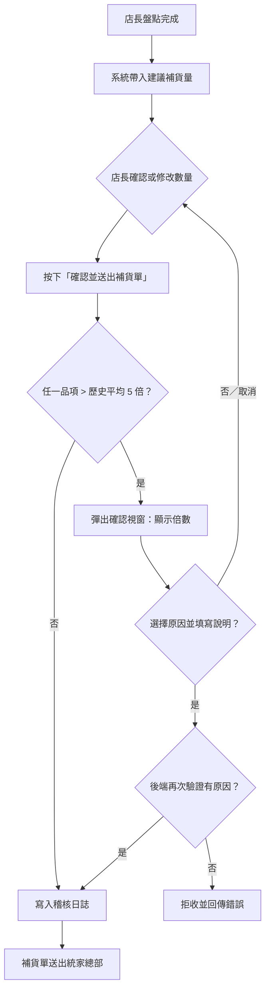

# 統家 EOS 智慧補貨系統

為統家企業資訊處開發組（組長：曾可蓮）設計的門市自動補貨系統。系統自動整合**銷售預測**與**門市盤點庫存**，算出每項商品的建議補貨量，店長確認（或微調）後發出補貨單。

## 1. 系統理念：從「藥劑師」到「醫師」

| | 舊 EOS（藥劑師） | 新 EOS（醫師） |
|---|---|---|
| 角色 | 事後檢查、攔截異常 | 事前診斷、主動開處方 |
| 店長負擔 | 自己估量、自己輸入 | 只需確認或微調 |
| 異常處理 | 暫緩訂單，等人工處理 | 即時詢問原因，說明後直接放行 |

**台南雨衣事件的教訓**
1. 欄位被限制為 3 位數，店長想訂 1,000 件卻只能輸入 999，**系統限制比人更容易出錯**。
2. 系統只會「擋」，不問「為什麼」，也不提供出口，導致活動開天窗。
3. 真正該做的是：用數據判斷「這個量是否異常」，異常時**詢問原因並記錄**，而非拒絕。

本系統的對應設計：移除位數上限；訂購量超過歷史平均 5 倍時，彈出視窗要求填寫原因，填完即放行，並寫入稽核日誌。後端另有第二道檢查，避免繞過前端。

## 2. 補貨模型與公式

- **銷售預測**：以歷史銷量（移動平均／季節與活動調整）預估「預測期間」的銷量 `D`。預測期間 = 前置時間 `L`（下單到到貨）＋ 盤點週期 `R`。
- **安全庫存**：`SS = Z × σd × √(L+R)`，`Z` 為服務水準係數（95% ≈ 1.65），`σd` 為日銷量標準差。
- **再訂購點**：`ROP = 日均銷量 × L + SS`。
- **本系統採用的週期盤點（Order-up-to）公式**：

```
建議補貨量 = (預測期間之預估銷售量 + Safety Stock) − 門市現有盤點庫存     （最小為 0，無條件進位）
```

範例（雨衣）：預估銷量 18 ＋ 安全庫存 10 − 現有庫存 5 = **23 件**。

**大額訂單判定**：`訂購量 > 歷史平均訂貨量 × 5`（雨衣歷史平均 20，門檻 100，輸入 1,000 即觸發確認）。

## 3. 資料結構（Schema）

```jsonc
// 商品主檔 + 門市庫存 + 銷售預測（mock_data.json 的 products）
{ "product_id": "P001", "name": "雨衣（輕便型）", "category": "雨具", "unit": "件",
  "stock": 5,            // 門市盤點庫存
  "forecast_sales": 18,  // 預測期間預估銷量
  "safety_stock": 10, "avg_order_qty": 20 }
// 訂單明細（POST /api/orders）
{ "store_id": "TN-0123", "operator": "王店長",
  "items": [{ "product_id": "P001", "qty": 1000, "reason": "區域大型活動", "note": "10/20 園遊會" }] }
// 稽核日誌 Audit Log（backend/data/audit_log.json，每品項一筆）
{ "log_id": "a1b2c3d4", "timestamp": "2026-10-09T22:30:00", "order_id": "PO...",
  "store_id": "TN-0123", "operator": "王店長", "product_id": "P001", "product_name": "雨衣（輕便型）",
  "suggested_qty": 23, "final_qty": 1000, "modified": true, "large_order": true,
  "reason": "區域大型活動", "note": "10/20 園遊會" }
```

對應 SQL（正式上線時）：

```sql
CREATE TABLE product   (product_id VARCHAR(10) PRIMARY KEY, name VARCHAR(100), category VARCHAR(30), unit VARCHAR(10), avg_order_qty INT);
CREATE TABLE inventory (store_id VARCHAR(10), product_id VARCHAR(10), stock INT, counted_at DATETIME, PRIMARY KEY(store_id, product_id));
CREATE TABLE forecast  (store_id VARCHAR(10), product_id VARCHAR(10), period_start DATE, forecast_sales INT, safety_stock INT);
CREATE TABLE order_line(order_id VARCHAR(30), product_id VARCHAR(10), qty INT, suggested_qty INT, reason VARCHAR(100), note TEXT);
CREATE TABLE audit_log (log_id VARCHAR(10) PRIMARY KEY, ts DATETIME, order_id VARCHAR(30), store_id VARCHAR(10), operator VARCHAR(30),
                        product_id VARCHAR(10), suggested_qty INT, final_qty INT, modified BOOLEAN, large_order BOOLEAN, reason VARCHAR(100), note TEXT);
```

## 4. 大額訂單確認作業流程



## 5. 店長 5 分鐘教學影片腳本

**0:00–1:00【簡介與導入背景】**
大家好，這支影片教您使用新的自動補貨系統。過去補貨要靠店長自己估量、自己輸入，台南門市曾因雨衣訂 1,000 件、欄位卻只能輸入 999 件，影響了活動。現在系統會像醫師一樣，先幫您算好建議量，您只要確認；遇到特殊狀況，也能放心訂大量。

**1:00–2:30【庫存管理理論與模型解析】**
（畫面：公式動畫）補貨量取決於三件事：接下來幾天預計賣多少、要多留多少緩衝（安全庫存）、現在架上還有多少。公式是：建議補貨量＝預估銷量＋安全庫存－現有庫存。以雨衣為例：18＋10－5＝23 件。安全庫存就像保險，避免突然多賣就缺貨；盤點越準，建議越準。

**2:30–4:30【系統實際操作示範】**
（畫面：操作錄影）①打開補貨畫面，看上方卡片：品項數、待確認品項。②表格「訂購量」已自動帶入建議量，大多數品項不用動。③示範修改：週末有區域活動，把雨衣改成 1,000 件。④按「確認並送出」，系統跳出視窗，說明這個量是平常的 50 倍，請選擇原因（例如區域大型活動）並補充說明。⑤按「確認原因並送出」，補貨單送出；下方紀錄區會看到這次的建議量、實際送出量與原因。

**4:30–5:00【結語與重點提醒】**
三個重點：盤點要確實；建議量只是起點，您最了解門市；訂大量時請說明原因，總部才能配合備貨。謝謝收看。

## 6. Quick Start

```bash
python -m venv .venv && source .venv/bin/activate   # Windows: .venv\Scripts\activate
pip install -r requirements.txt
uvicorn backend.main:app --reload --port 8000        # 在專案根目錄執行
```

開啟瀏覽器：<http://localhost:8000>（後端同時提供前端頁面）；API 文件：<http://localhost:8000/docs>。

測試大額情境：將「雨衣」訂購量改為 `1000` → 送出 → 填寫原因。

| Endpoint | 說明 |
|---|---|
| `GET /api/inventory` | 商品、庫存與自動計算的建議補貨量 |
| `POST /api/orders` | 送出補貨單；大額訂單須附原因，寫入稽核日誌 |
| `GET /api/audit-logs` | 查詢送單與修改紀錄 |

> 註：本專案使用 Mock Data 示範，預估銷量與安全庫存正式上線時應由預測模組與盤點系統提供。

---

## 7. v2 擴充功能

- **登入與角色**：門市店長只能看自己門市；總部（曾可蓮組長）可看全店訂單與稽核日誌並確認訂單。示範帳號 `tn01` / `tp01` / `kh01` / `hq01`，密碼 `demo1234`（Demo 用，正式環境請改雜湊密碼與 SSO）。
- **每日盤點**：店長輸入實際庫存，儲存後建議量即時重算；保留歷次盤點履歷。
- **預測模型升級**：近 7 日加權移動平均 × 預測天數 × 天氣／活動係數；安全庫存 = Z × σ × √天數（σ 取近 14 日實際銷量標準差）。
- **進貨單位進位**：依箱入數進位（如礦泉水 24 入）；鮮食以效期上限避免過量。
- **訂單履歷與總部確認**：訂單狀態「已送出 → 總部已確認」；總部總覽顯示各店盤點／送單／大額狀況。
- **執行時資料**：訂單、盤點與日誌存於 `backend/data/runtime.json`（已加入 .gitignore）。

更新檔案後請停止並重新啟動伺服器。

## 8. GitHub Pages 展示版（免伺服器）

`docs/` 是純靜態展示版：後端邏輯已搬進瀏覽器（`docs/js/mock-api.js`），資料存在 localStorage。
啟用方式：GitHub → Settings → Pages → Source 選 `Deploy from a branch`，Branch 選 `main`、資料夾選 `/docs` → Save。
網址：`https://<帳號>.github.io/<倉庫名>/`。
